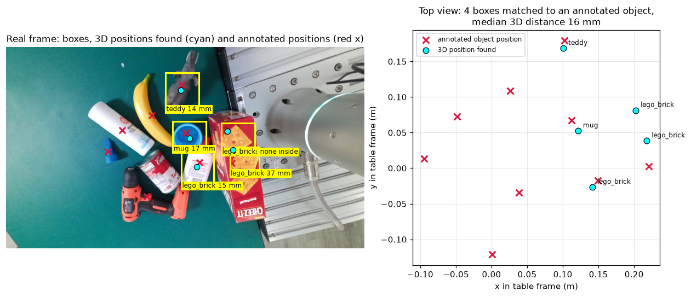
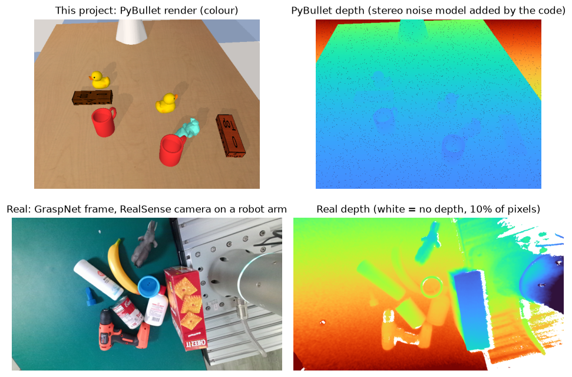
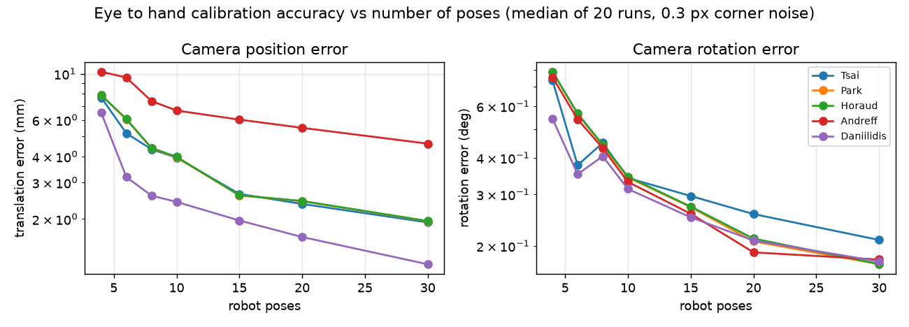
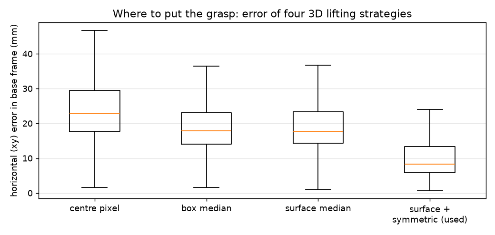
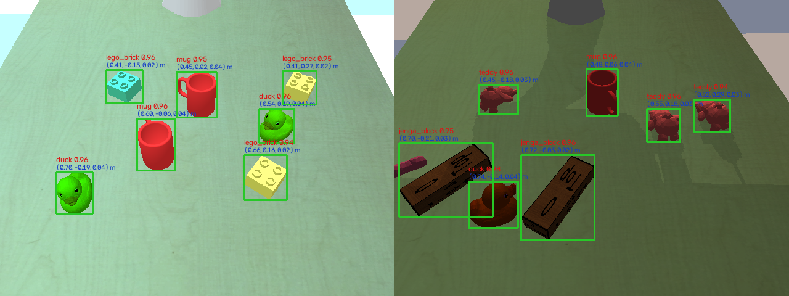
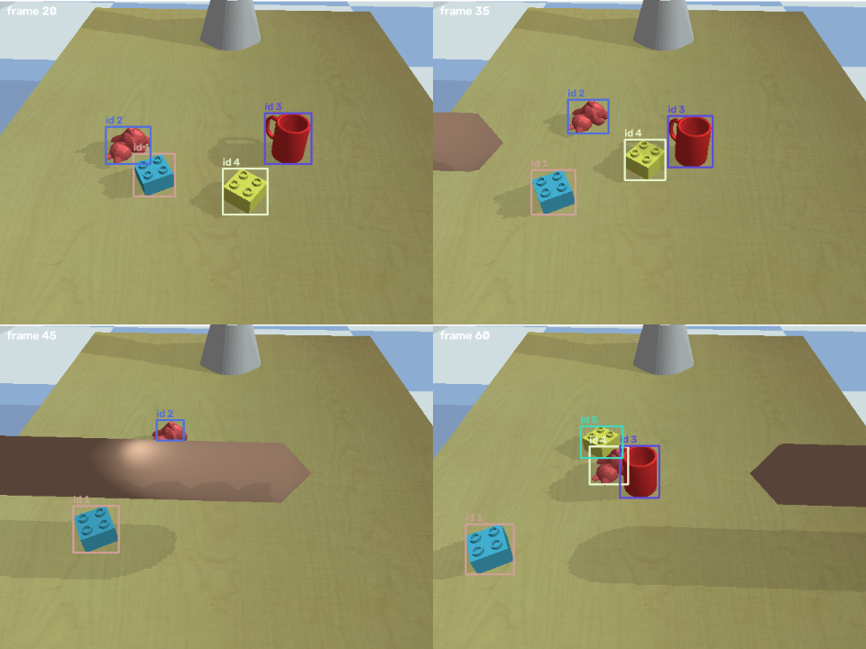
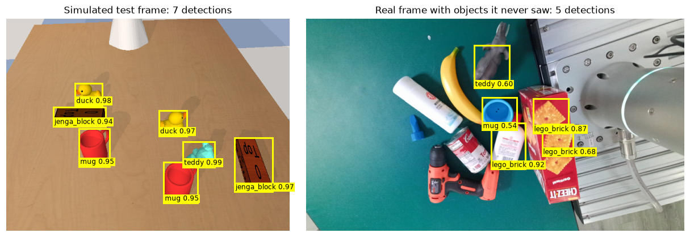

# RGBD Object Detection and Tracking for Grasp Planning

Perception for a collaborative robot arm: find objects on a work surface, locate each one in 3D in the
robot's base frame, and keep its identity over time, so a grasp planner knows what to pick and where.



*The full pipeline on a real RealSense frame recorded by a camera on a robot arm (GraspNet 1Billion): detected
boxes, the 3D positions found (cyan) and the annotated object positions (red). The median distance is
16 mm on the 4 matched boxes. Details in [Simulation versus real data](#simulation-versus-real-data).*



*Top: a frame from this project's simulated dataset. Bottom: the real frame, with clutter, shiny surfaces and
missing depth that the simulator does not produce.*

The main results below are measured in a simulated workcell (PyBullet: Franka Panda arm, table, five object
classes, RGBD camera), which provides exact ground truth for every stage, so each stage is measured on its own.
The real frame above shows what simulation leaves out.

## Pipeline

```
RGBD camera ──► YOLOv8n detection ──► 3D lifting (depth + intrinsics) ──► base frame (hand eye calibration) ──► ByteTrack ──► grasp targets
```

| Stage | What it does | Code |
| --- | --- | --- |
| Simulated workcell | Panda arm, table, mug / duck / teddy / lego brick / jenga block, unlabelled clutter, randomised lighting, colours and camera pose; stereo style depth noise that grows with Z squared | `perception/sim_scene.py` |
| Detection | YOLOv8n fine tuned from COCO weights on 600 rendered images | `scripts/02_train_yolo.py` |
| Hand eye calibration | Eye to hand calibration of the cell camera: PnP on a gripper mounted board, then AX = XB (Tsai, Park, Horaud, Andreff, Daniilidis) | `perception/handeye.py` |
| 3D lifting | Depth inside each box back projected with the intrinsics, table plane and background removed, hidden back half completed | `perception/lift3d.py` |
| Tracking | ByteTrack implemented from the paper: constant velocity Kalman filter, Hungarian matching, second pass over low confidence boxes | `perception/tracker.py` |

## Results

All numbers below are produced by the scripts in this repository and saved in `results/`.

### Detection (150 held out test scenes, 757 boxes)

| Metric | Value |
| --- | --- |
| mAP50 | 0.995 |
| mAP50:95 | 0.988 |
| Precision | 0.997 |
| Recall | 0.992 |

Per class mAP50:95: mug 0.995, duck 0.995, teddy 0.983, lego_brick 0.984, jenga_block 0.984. These are simulation scores and an upper bound for real images.

### Hand eye calibration

The calibration used in every result below (Tsai's method, 15 robot poses, 0.3 px corner noise) is off by 2.3 mm and 0.40 degrees. Over 20 repeated trials, error falls as poses are added, and Daniilidis (dual quaternions) gave the lowest translation error (2.0 mm median at 15 poses, against 2.6 mm for Tsai).



### 3D position in the robot base frame (detections with confidence 0.5 or more)

| Lifting strategy | Horizontal error, median | 3D error, median | 3D error, 90th percentile |
| --- | --- | --- | --- |
| Centre pixel depth | 22.8 mm | 29.0 mm | 45.6 mm |
| Median depth in box | 17.9 mm | 21.6 mm | 35.8 mm |
| Surface points, median | 17.7 mm | 22.0 mm | 33.3 mm |
| Surface + symmetric completion (used) | 8.3 mm | 8.6 mm | 22.4 mm |
| Used method, perfect calibration | 6.6 mm | 6.9 mm | 19.9 mm |
| Used method, ground truth boxes | 8.3 mm | 8.5 mm | 22.4 mm |

Measured on 724 matched detections. The last two rows separate the error sources: calibration adds about 1.7 mm, and detector boxes versus perfect boxes make almost no difference, so the remaining error comes from estimating an object's centre from a partial view.





### Tracking (12 sequences x 80 frames, same detector and Kalman filter for both trackers)

| Condition | Tracker | ID switches | Fragmentations | MOTA | IDF1 |
| --- | --- | --- | --- | --- | --- |
| crossing | SORT style baseline | 0 | 28 | 0.927 | 0.962 |
| crossing | ByteTrack | 4 | 13 | 0.938 | 0.921 |
| occluder | SORT style baseline | 15 | 36 | 0.853 | 0.861 |
| occluder | ByteTrack | 13 | 22 | 0.866 | 0.869 |
| fast | SORT style baseline | 16 | 39 | 0.917 | 0.762 |
| fast | ByteTrack | 17 | 34 | 0.922 | 0.759 |
| all | SORT style baseline | 31 | 103 | 0.900 | 0.862 |
| all | ByteTrack | 34 | 69 | 0.910 | 0.849 |

**What ByteTrack improved:** over all sequences it cut track fragmentations by 33% (103 to 69) and raised MOTA from 0.900 to 0.910. Its second pass keeps a track alive on the weak detections of a partly hidden object instead of letting it drop.

**What it did not improve:** identity switches. ByteTrack made 34 against the baseline's 31 (10% more), and IDF1 fell slightly. It had fewer switches only in the occluder sequences (13 vs 15). In the crossing sequences it made 4 against 0. The low score pass is the only difference between the two trackers, so those extra switches come from it; the likely reason is that when two objects overlap, the extra weak detections give a track more chances to latch onto the wrong object. The detector here is nearly perfect (trained and tested in simulation), so there are few weak detections worth rescuing, which is where ByteTrack normally earns its gain. Whether real images change this balance is untested.

**Fast motion is the weak spot for both trackers** (IDF1 0.76 and 0.76, the lowest of the three conditions). The likely cause: when an object moves more than its own width between frames, the predicted and detected boxes stop overlapping and IoU matching fails.

The example below is a failure case shared by both trackers. The arm passes over the teddy and the yellow brick; when they reappear, the teddy picks up the brick's old identity (id 4) and the brick starts a new one. The SORT style baseline makes exactly the same swap on this sequence.



### Latency (2 CPU cores, no GPU, 512 px input, preprocessing + inference + NMS)

| Runtime | ms per image (mean) | p90 | images per second |
| --- | --- | --- | --- |
| PyTorch, batch 1 | 45.5 | 50.3 | 22.0 |
| PyTorch, batch 8 | 40.5 | 42.2 | 24.7 |
| ONNX Runtime, batch 1 | 48.8 | 51.6 | 20.5 |

ONNX Runtime was not faster on this CPU (0.93x the speed of PyTorch at batch 1), and its boxes differ from PyTorch's by at most 0.63 px. Numbers are for a 2 core CPU without a GPU.


## Simulation versus real data

Everything above is measured in simulation. To show what that leaves out, `scripts/08_sim_vs_real.py` puts a
simulated test frame next to a real one: the public example frame of GraspNet 1Billion (Fang et al., CVPR 2020),
recorded by a RealSense camera mounted on a robot arm and downloaded from the
[`graspnet-baseline`](https://github.com/graspnet/graspnet-baseline) repository at run time.

In that comparison (second figure at the top of this page), the real frame has what the simulator leaves out: everyday objects touching each other, shiny and dark
surfaces, the robot's own hardware in view, and no depth value at 10% of the pixels.

The same script runs the detector, trained only on simulated images, on the real frame. None of the real
objects belong to its five classes, so there is nothing to score, but how it behaves is the point:



- **Two guesses are reasonable:** the grey toy animal becomes "teddy" (0.60) and the blue cup becomes "mug" (0.54).
- **Three are confidently wrong:** a white bottle is called "lego_brick" at 0.92, and the printed crackers on
  the box become two more Lego bricks (0.87 and 0.68).
- **The rest get no box:** the banana, drill, can, spray bottle and small blue part, as expected for a detector
  that only knows five classes.

A confident wrong answer is the dangerous failure for a robot, because nothing downstream can tell it apart
from a correct one. The fix is real training data (GraspNet provides object masks and boxes for its real
frames) or an open vocabulary detector, and training and scoring on real images is the next step.

### The full pipeline on the real frame

`scripts/09_real_frame_3d.py` runs detection and 3D localisation together on the same real frame. The frame
comes with the camera intrinsics and the annotated 6D pose of every object, but not with a camera to robot
transform, so the table plane is fitted first and used as the base frame. The 3D step does not use the class,
so every box is still placed in 3D and compared with the annotated object whose position falls inside it.
The result is the first figure at the top of this page.

| Box (predicted class, score) | Real object inside | 3D distance to its annotated position |
| --- | --- | --- |
| teddy 0.60 | toy animal | 13.8 mm |
| lego_brick 0.92 | white bottle | 15.1 mm |
| mug 0.54 | blue cup | 17.2 mm |
| lego_brick 0.68 | cracker box | 36.7 mm |
| lego_brick 0.87 | part of the cracker box (no annotated position inside) | not measured |

- **Median distance on the 4 matched boxes: 16 mm**, against 8.6 mm in simulation. With four objects,
  and annotated positions that are model origins rather than exact centres, this is a rough check, not a
  benchmark.
- **The 37 mm case is a box problem, not a 3D problem.** The box covers only one printed cracker on the
  cracker box, so the position found is the centre of that patch, not of the whole box. A wrong box gives a
  wrong grasp target even when the 3D step works.
- **Tracking is not checked here**, because the example is a single image.

## How to run

```bash
python3.11 -m venv .venv && source .venv/bin/activate
pip install -r requirements.txt

python scripts/01_generate_dataset.py          # 600 train, 120 val, 150 test images (about 5 min)
python scripts/02_train_yolo.py                # YOLOv8n, 25 epochs, 512 px (about 75 min on 2 CPU cores)
python scripts/03_handeye_calibration.py       # calibration accuracy vs number of poses (seconds)
python scripts/04_evaluate_detection_3d.py     # mAP on test scenes and 3D error in the base frame
python scripts/05_generate_tracking_sequences.py
python scripts/06_evaluate_tracking.py         # ByteTrack vs SORT style baseline
python scripts/07_benchmark_latency.py         # CPU latency, PyTorch vs ONNX Runtime
python scripts/08_sim_vs_real.py               # simulated vs real frame, detector on a real frame
python scripts/09_real_frame_3d.py             # detection and 3D localisation on a real frame
```

The trained weights are included as `models/best.pt`, so training can be skipped. Scripts 04, 06 and 07 still need
the rendered images, so run 01 and 05 first. Each split uses its own random seeds, so test layouts, lighting and
camera poses are never seen in training.

## Design decisions

- **YOLOv8n:** real time on modest hardware, simple to fine tune, exports cleanly to ONNX. A segmentation head
  would give cleaner depth per object; it is the first upgrade listed below.
- **3D lifting:** the camera sees only the front and top of an object, so the median of the visible surface is
  biased toward the camera. Completing the hidden half (assume the object is about as deep as it is wide, and
  that it rests on the table) cut the horizontal error by more than half. The comparison is in the results.
- **Calibration error is included:** 3D errors use the camera pose from a 15 pose hand eye calibration, not the
  true pose, so they show what a real robot would see. The true pose result is reported next to it.
- **ByteTrack instead of DeepSORT:** objects on a work surface are often identical copies, so appearance
  embeddings add little. ByteTrack's low score pass targets partial occlusion at almost no extra cost. The
  comparison above shows it reduced fragmentation but not identity switches in this setup.

## Limitations, stated plainly

- **Simulation, not a real robot.** Images come from PyBullet's TinyRenderer with randomised lighting and
  colours and a stereo depth noise model. Real images are harder (reflections, motion blur, sensor artefacts),
  so detection scores here are an upper bound. One real frame is checked, without a score (see Simulation
  versus real data).
- **Hand eye corners are simulated.** Board corners are obtained by projecting the board with the true camera
  and adding 0.3 px noise, which stands in for a corner detector. PnP, AX = XB and the error analysis are real.
- **3D ground truth** is each object's bounding box centre from the simulator; for irregular shapes (duck,
  teddy) that is itself an approximation of the grasp point.
- **Tracking is in image space.** Boxes are tracked in 2D pixels, which works for a fixed camera but not for
  a camera that moves with the wrist.
- **No ROS2 node in this version.** The pipeline is plain Python modules; wrapping it as ROS2 nodes
  (camera, detector, lifting, tracker publishing tracked poses with tf2) is the next step.

## Next steps

1. Train and score on real images (GraspNet), and measure how much accuracy drops from simulation to real.
2. YOLOv8 segmentation masks for cleaner per object depth.
3. Track in 3D in the robot base frame, so a moving wrist camera does not break tracks.
4. ROS2 nodes and a real RGBD camera, then compare against these simulation numbers.

## Companion project

[3D workspace reconstruction and segmentation in C++ with PCL](https://github.com/ManojNagendraKumar/workspace_reconstruction): fuses several wrist camera views of the same workcell and segments the objects.
